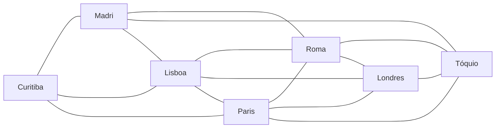

# Viagem-Internacional-EDNL

Bloco mermaid gerado do grafo dos caminhos possíveis

## Todos os voos e seus pesos de viagem, custo, distancia e tempo:
Todos os preços são um valor aproximado, os valores mudam constantemente por causa de data, aerolíneas e etc.

| # | Trecho | Transporte | Custo (R$) | Distância (km) | Tempo (h) |
|---|---|---|---:|---:|---:|
| 1 | Curitiba – Madri | Avião (1 escala) | 3.200 | 8.723 | 14,0 |
| 2 | Curitiba – Lisboa | Avião (direto) | 3.000 | 8.274 | 11,0 |
| 3 | Curitiba – Paris | Avião (1 escala) | 3.500 | 9.744 | 17,0 |
| 4 | Madri – Lisboa | Avião (direto) | 300 | 514 | 1,3 |
| 5 | Madri – Roma | Avião (direto) | 500 | 1.329 | 2,5 |
| 6 | Madri – Tóquio | Avião (direto) | 3.400 | 10.770 | 14,0 |
| 7 | Lisboa – Paris | Avião (direto) | 500 | 1.470 | 2,7 |
| 8 | Lisboa – Londres | Avião (direto) | 450 | 1.565 | 2,8 |
| 9 | Lisboa – Roma | Avião (direto) | 500 | 1.839 | 3,0 |
| 10 | Paris – Londres | Trem (Eurostar) | 450 | 492 | 2,3 |
| 11 | Paris – Roma | Avião (direto) | 600 | 1.101 | 2,1 |
| 12 | Paris – Tóquio | Avião (direto) | 3.500 | 9.710 | 14,0 |
| 13 | Londres – Roma | Avião (direto) | 450 | 1.443 | 2,6 |
| 14 | Londres – Tóquio | Avião (direto) | 3.200 | 9.591 | 14,0 |
| 15 | Roma – Tóquio | Avião (direto) | 3.000 | 9.906 | 12,5 |

**Critérios:**
- **Custo:** passagem econômica só de ida, valor típico pesquisado em novembro de 2026.
- **Distância:** linha reta entre os aeroportos; Paris–Londres usa a distância pelos trilhos do Eurostar.
- **Tempo:** duração total da viagem, incluindo escalas.